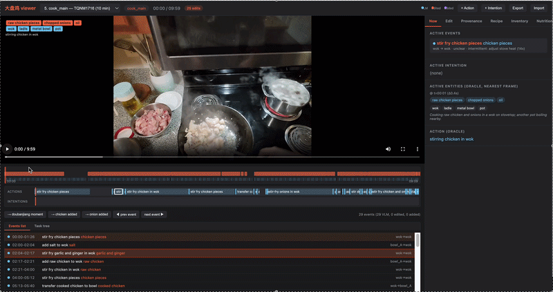

## Projects
---
### Egocentric Cooking Video Analysis

  VLMs
  Egocentric Video Understanding
  Action Recognition

This project investigates how vision-language models can transform long, untrimmed egocentric cooking videos into structured representations of cooking processes. I developed a VLM-based evaluation pipeline for fine-grained action recognition, while ongoing research links action sequences with object identity, location, and physical state to study causal provenance and refine uncertain predictions. 

---
### SkinSense: AI-Assisted Skin Lesion Documentation and Tracking

  Computer Vision
  SAM
  MedGemma
  React + FastAPI

We developed SkinSense, a non-diagnostic, AI-assisted platform for documenting and tracking skin lesions over time. It organizes images, symptoms, and visible changes into longitudinal records that support communication with healthcare professionals. The system combines computer vision–based lesion segmentation and measurement with multimodal AI to generate consistent, non-diagnostic visual descriptions. 

[View Report](/content/SkinSense_Final_Report.pdf)

---
###  Urban Informal Settlement Detection 

  Machine Learning
  Remote Sensing
  Sentinel-2 Imagery
  Google Earth Engine

We developed a machine-learning framework that combines Sentinel-2 imagery with multi-scale spectral, textural, and structural features to map urban informal settlements across Guangzhou. The best-performing model achieved 93% overall accuracy, demonstrating a scalable approach to large-area urban analysis. 

[View Report](/content/Detecting_Urban_Informal_Settlements_with_RS.pdf)

---
### Fire Response Situational Awareness Platform

  Machine Learning
  REST API
  Geospatial Data

We developed a citywide fire-risk assessment API to support situational awareness for the Philadelphia Fire Department. The system combines machine learning–based risk modeling with geospatial data integration to provide on-demand parcel information and fire-risk assessments through an interactive web application. 

[View Report](/content/Fire_Response_Situational_Awareness_API.html)

---
### Train Occupancy Prediction

  R
  Multinomial Logistic Regression
  Geospatial Data

We developed a spatial train-occupancy prediction framework for Belgium’s rail network. The system combines multinomial logistic regression, rail-network analysis, and cost–benefit evaluation to forecast occupancy levels and support service-planning decisions, achieving 80% overall accuracy. 

We also designed SmartOccupancy, a web-based decision-support tool for identifying capacity imbalances and evaluating service adjustments. <a href="https://www.youtube.com/watch?v=i8b7DR42uhw">Watch the project video</a>

[View Code](/content/occupancy_prediction.html)

Page template forked from <a href="https://github.com/evanca/quick-portfolio">evanca</a>

<!-- Remove above link if you don't want to attibute -->
